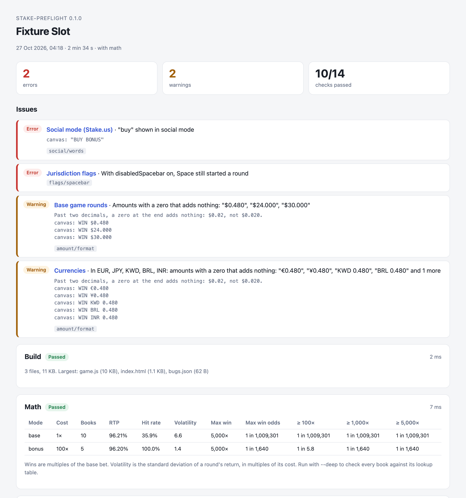

# stake-preflight

Checks a Stake Engine game before you submit it. It serves your build the way Stake's CDN does, plays it against a mock RGS, and writes a report with a screenshot of everything it looked at.



I made this while shipping slots on Stake Engine. Review kept sending games back for things that take a minute to fix and an hour to find: a bet that ignored the RGS's bet levels, `$0.020` on a win label, the word "buy" in social mode, a replay that called the wallet. Each of those is a check here now.

## Usage

Needs Node 22.15 or newer and Google Chrome (or Chromium).

```sh
npx github:egedev0/stake-preflight ./build --math ./math
```

`./build` is the folder you upload as the frontend. `--math` is the folder you upload as the math: `index.json`, the lookup tables and the books. Without it, the checks that play rounds are skipped.

A full run takes five to ten minutes; `--quick` covers the main checks in about two. The report goes to `preflight-report/index.html`, with a `report.json` next to it.

The command exits with 0 when nothing failed, 1 when a check found an error (or a warning, with `--strict`) and 2 when it couldn't run, so it also works in CI.

To see it on the small demo game in this repo:

```sh
git clone https://github.com/egedev0/stake-preflight
cd stake-preflight && npm install && npm run demo
```

## What it checks

| Check | |
|---|---|
| `build` | `index.html` loads nothing by an absolute path or from another host. No `.env` or `.DS_Store` in the upload. |
| `math` | `index.json`, the lookup tables and the books agree. RTP, hit rate, volatility, max win and tail odds for every mode. `--deep` checks every book. |
| `load` | The game opens from `/<game>/<version>/index.html` and authenticates. No console errors, failed or external requests, or page scroll. |
| `play` | A loss, a small win, a big win and a free spins round. Bets use the levels and default the RGS sends, wins end with `/wallet/end-round`, the balance and amounts are formatted right. |
| `input` | Spin pressed ten times a second, then again with a slow RGS. A second bet must never go out while a round is open. |
| `resume` | An unfinished round from `/wallet/authenticate`, with and without `event`. The game plays it out, ends it and carries on at its bet. |
| `replay` | Every mode replayed through `/bet/replay`. The bet and payout show before it plays, no wallet calls. Also a replay with only the required parameters, and one that doesn't exist. |
| `social` | `social=true` and `jurisdiction.socialCasino`: no real-money words anywhere the game shows text. |
| `flags` | `disabledSpacebar`, `minimumRoundDuration`, and the RTP, session timer and net position display flags. |
| `balance` | With a zero balance no bet goes out. |
| `errors` | An expired session, a failed bet, an RGS that can't be reached. RGS requests go to the host in `rgs_url`. |
| `screens` | The seven sizes of Stake's launcher, and resizing without a reload. |
| `locales` | The game opened in other languages. |
| `currencies` | The balance keeps two decimals in yen, dinar and the rest. |

Run some with `--only play,replay` or leave some out with `--skip locales`.

## How it sees the game

Nothing has to be added to the game. It watches from the outside:

- The RGS is a mock that answers like the real one. Amounts are in millionths, a win stays open until `/wallet/end-round`, an unfinished round comes back without `event` until the game saves one.
- Rounds start with Space, which every Stake game supports. An intro screen is passed with its Continue, Start or Play button, or with the steps you configure.
- Text is read from the page and from what the game draws: canvas `fillText` calls (Pixi, Phaser and most engines draw text that way) and the SVG behind Pixi's `HTMLText`. Text baked into images or drawn with bitmap fonts can't be read, so check the screenshots for those.
- Each mode plays the same books every run: the first loss, small win, big win and max win in its lookup table, and the shortest of its first free spins rounds.
- The build is served as files only, matched by exact name, the way Stake's CDN serves it. A path that only works because your disk ignores case shows up as a 404.

## Config

Optional. Put `preflight.config.json` where you run the command, or pass `--config <file>`:

```json
{
  "spin": [{ "key": "Space" }],
  "start": [{ "click": [0.5, 0.62] }],
  "screens": {
    "rules": [{ "click": [0.96, 0.05] }],
    "buy": [{ "selector": "button.buy-bonus" }]
  },
  "social": { "extra": ["coins"], "allow": [] },
  "langs": ["de", "es", "br", "ja"],
  "currencies": ["EUR", "JPY", "KWD"],
  "minimumRoundDuration": 3,
  "limits": { "rtp": [0.96, 0.97], "maxWin": 25000 },
  "timeouts": { "load": 60, "round": 120, "replay": 45 }
}
```

`timeouts` are in seconds. `round` is how long a round may go without saving progress (`/bet/event`) or ending, so a long bonus round that keeps moving gets the time it needs.

A step is one of `{ "key": "Enter" }`, `{ "click": [x, y] }` with x and y as fractions of the screen, `{ "selector": "css selector" }` or `{ "wait": 500 }`.

`screens` opens the game's own windows (rules, buy menu, settings) so their text gets read in social mode. If there's a `buy` entry, it's also tried with `disabledBuyFeature` on.

The words of the game's own name (its `<title>`) are never flagged in social mode, and neither is "Stake" as in Stake Engine. `social.allow` takes more, `social.extra` adds your own.

`limits` are your own targets for the math report; nothing is assumed when they're left out.

## From code

```js
import { preflight } from 'stake-preflight';

const report = await preflight({ build: 'build', math: 'math', quick: true });
console.log(report.summary); // { errors, warnings, passed, skipped, sections }
```

## What it can't tell you

It doesn't judge art, animation or the feel of the game, which is most of what review scores. A clean report means the mechanical things are right. Look through the screenshots and play it on a phone too.

Some checks come from review feedback rather than Stake's docs, and the rules change. If a check disagrees with what review told you, please open an issue.

Not affiliated with Stake.

## License

MIT
